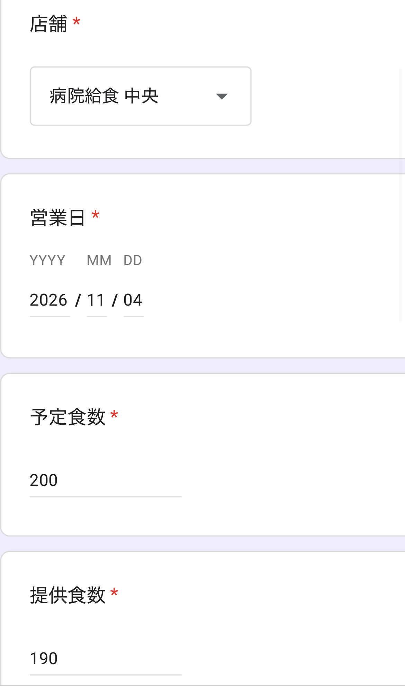
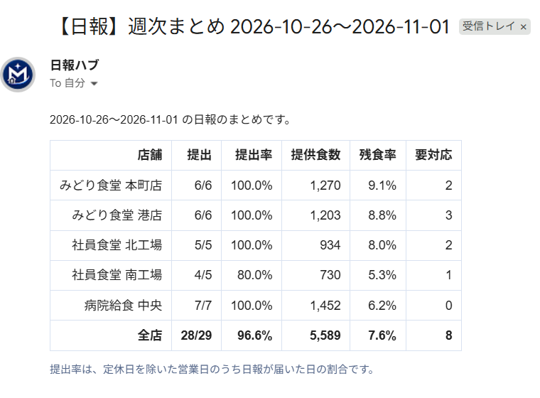
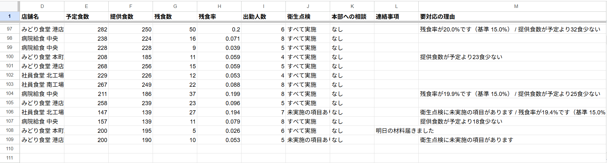
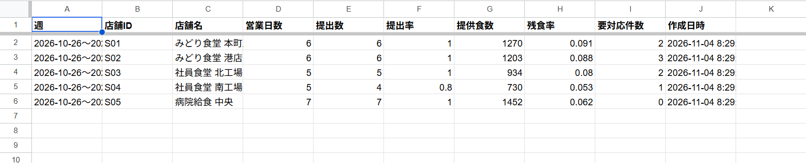

# 日報ハブ（Daily Report Hub）

複数店舗の日報を Googleフォームで集め、スプレッドシートに1か所でまとめる Google Apps Script です。

- 日報が届いたら、整えて「日報」シートへ記録。同じ店舗・同じ日を送り直すと上書きし、修正回数を残す
- 衛生点検の未実施・本部への相談・残食率の超過・提供不足があれば、本部へすぐメール
- 毎日決まった時刻に、未提出の店舗へリマインド（定休日の店舗は除く）
- 毎週月曜に、前週の提出率・提供食数・残食率・要対応件数を店舗別に集計し、本部へメール

```
各店舗 ─ Googleフォーム ─▶ handleFormSubmit ─▶「日報」シート
                                   └─ 要対応なら ─▶ 本部へメール
毎日 15時 ─ remindMissing ─▶ 未提出の店舗へリマインド／本部へ一覧
毎週月曜 8時 ─ sendWeeklySummary ─▶「週次集計」シート／本部へまとめ
```

## 画面

店舗名と数値は、すべてデモ用の架空のデータです。

| 店舗の入力（Googleフォーム） | 週次まとめのメール |
|---|---|
|  |  |

「日報」シート。確認が必要な日報には、理由を自動で書き込みます。



「週次集計」シート。同じ週を作り直しても、行は重複しません。



## ファイル

| ファイル | 役割 |
|---|---|
| `src/Logic.js` | 回答の整形・要対応の判定・未提出の判定・週次集計。シートやメールに触れない純粋関数 |
| `src/Store.js` | 設定・シート・メールの読み書き |
| `src/Handlers.js` | トリガーから呼ばれる3つの処理 |
| `src/Setup.js` | メニュー、初期設定（シート・フォーム・トリガー）、デモデータ |
| `test/` | Node のテスト（`npm test`） |

## 安全のための作り

- **メールは既定で送らない。** スクリプト プロパティで `DRY_RUN=false` にするまでは「送信ログ」に記録だけします。
- 宛先がない、1日の送信上限に近い、のどちらかのときも送りません。結果はすべて「送信ログ」に残ります。
- 同時に回答が届いても同じ行を二重に書かないよう、ロックをかけて順番に処理します。
- 不正な回答（マスタにない店舗、整数でない数値、提供食数を超える残食）は記録せず、「受付エラー」に理由を残します。
- シートに書く文字列は、先頭が `=` などの数式とみなされる記号なら無害化します。メールの本文の値はエスケープします。
- 週次集計は同じ週を作り直しても重複しません。トリガーの登録も、何度実行しても重複しません。

## 設定（スクリプト プロパティ）

| キー | 既定 | 内容 |
|---|---|---|
| `HQ_EMAIL` | なし | 本部の宛先。未設定なら本部へのメールは送らない |
| `DRY_RUN` | `true` | `false` にしたときだけ実際に送信する |
| `REMIND_HOUR` | `15` | 未提出リマインドの時刻（時） |
| `WEEKLY_HOUR` | `8` | 週次まとめの時刻（月曜・時） |
| `LEFTOVER_ALERT_RATE` | `0.15` | 残食率がこれを超えたら要対応 |
| `SHORTAGE_ALERT_RATE` | `0.1` | 予定より提供がこの割合を超えて少なければ要対応 |

## セットアップ

1. Google スプレッドシートを新しく作る
2. 「拡張機能」→「Apps Script」を開き、`src/` の4つの `.js` と `appsscript.json` を貼り付ける
   （`appsscript.json` はエディタの「プロジェクトの設定」→「マニフェストを表示」で表示されます）
   clasp を使う場合は `.clasp.json.example` を `.clasp.json` にして `clasp push`
3. スクリプト プロパティに `HQ_EMAIL` を設定する（`DRY_RUN` はまだ設定しない）
4. スプレッドシートを開き直すと「日報ハブ」メニューが出る
5. 「デモ用の架空データを入れる」→「初期設定」の順に実行し、表示されたフォームのURLを開く

## 動作確認

2026年11月4日に、デモ用の Google アカウントで次の7項目を確認しました。

- [x] フォームから1件送ると「日報」シートに1行増える
- [x] 同じ店舗・同じ日をもう一度送ると、行は増えずに上書きされ、修正回数が1になる
- [x] 衛生点検「未実施の項目あり」で送ると、「送信ログ」に要対応が `DRY_RUN（未送信）` で残る
- [x] 残食数を提供食数より多くして送ると、「日報」には入らず「受付エラー」に理由が残る
- [x] メニューの「いま未提出の店舗を確認」で、未提出の店舗だけが「送信ログ」に並ぶ（定休日の店舗は出ない）
- [x] メニューの「前週のまとめを作成」で「週次集計」に店舗別の行ができ、もう一度実行しても重複しない
- [x] `DRY_RUN=false` にして、週次まとめのメールが `HQ_EMAIL` に届く（確認後は `DRY_RUN` を戻す）

## テスト

```bash
npm test
```

判定と集計のロジック（日付、定休日、要対応、未提出、週次集計、エスケープ、セルの無害化）と、
Apps Script に読み込むファイルの名前の重複・構文を確かめます。
